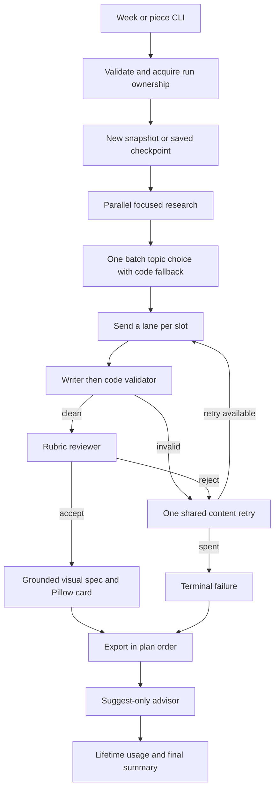

# Architecture

The pipeline is a fixed workflow. Plain typed Python agents handle one role each;
LangGraph owns routing, parallelism, retries and SQLite checkpoints. Model choice is
configuration, independent of orchestration. [DESIGN.md](DESIGN.md) section 6 remains
the settled requirements authority.

## Boundaries and data flow

`config.py` loads file contracts, strict angle pools and brand rules. `pipeline.py`
validates startup inputs, freezes policy, creates the graph and contains expected slot
failures. Every slot finishes as shipped, dropped_quality, failed_research, failed_api,
failed_budget or failed_output. Different slots do not share a content retry.

`agents.py` receives ResearchRequest, WriteRequest, ReviewRequest or VisualRequest;
agents never receive WeekState. Research alone has callable tools from `tools.py` and
`skills/search_kb.py`/`web_search.py`. It uses BM25 aliases and the same chat model to
judge KB matches, with at most four search actions. Web hits retain actual page evidence;
summary snippets/fetch failures cannot support claims. Public HTTP(S) fetches reject
private targets and validate redirects. Assigned topics use the configured KB/angles
producer, regardless of an angle ID's prefix. Code reserves all valid later topic
proposals before deterministic fallback and excludes the last four completed runs.

Writers get only their research pack and file instructions. Shared `brand_rules` is
instruction text for writers/reviewer/visual and executable rules for validation.
Code adds numbering, applies only logged safe fixes, checks weighted tweet length and
source IDs, then passes the exact approved candidate and identical evidence to review.
Review scoring requires every rubric criterion and hard-fail flag; average/threshold
and approval are computed by code. An accepted boolean from the model is never trusted.
The model still owns factual grounding judgment; valid source IDs alone prove no claim.
The private reviewer tool schema spells out the current file-configured criterion and
hard-fail keys, with score bounds. Its typed response converts back to the unchanged
canonical dictionary contract before validation/scoring. Criterion reasons are required;
false flags may omit reasons, true flags still require them, and extra string reasons
remain allowed. This representation helps producers emit the required fields; it does
not change approval policy or establish a model's grounding quality.

`images.py` validates both modeled and fallback overlays before Pillow rendering.
`trail.py` deduplicates stable record IDs and exports approved text unchanged. JSON
contracts live in `models.py`/`contracts.py`; `schemas.py` exports their schemas.

## Model calls and recovery

`model_client.py` prepares configured LangChain provider adapters and requests raw
structured responses. The wrapper retains returned usage even when parsing fails,
normalizes cache/thinking tokens without double counting, and makes every retry pass
through the shared ledger. Transient failures get up to three retries; truncation gets
one 1.5x output retry; malformed structures get one repair. These are separate from the
single content retry. Initialization/credential failures before dispatch create no
uncertain billed charge. Errors written to artifacts use safe failure types.

`durability.py` owns an exclusive OS lock, read-only resume preflight, snapshot hashes
and persisted thread identity. Mutable live policy cannot mix into an existing run.
SQLite persists parent and per-lane subgraph checkpoints. Resume invokes the graph
with no new input, preserving pending namespaces rather than restarting a fresh plan.
Completed resume returns saved state without factories. The ledger recovers only after
ownership: reserved calls release; dispatched unresolved calls remain uncertain.
Call numbering advances over all prior ledger IDs, including released ones. Usage and
stage trails are retained. Search/image counters are saved incrementally in a separate
artifact under a shared async lock.
Saved review/visual/advisor results additionally carry the exact request hash. An
interruption after their trail append can recover that typed result rather than replacing
its artifacts with a different response. Input mismatches fail closed.

An unfinished node can replay work after a crash. In particular, focused research and
topic selection have gather operations: a sibling's finished call is not individually
checkpointed until the parent node finishes. Tool/model calls inside a research loop
have the same window. Billed responses lost before checkpointing can be billed again;
there is no exactly-once billing guarantee. Trails deduplicate records, not model calls.
The schema-versioned snapshot format intentionally rejects older/missing/incompatible
run metadata. Local checkpoint folders should remain under their operator's control.

## Advisor and storage

`advisor.py` is a plain typed agent after export. It reads the frozen allowed instruction
files and saved research/draft/review/final records. Structured edits identify exact
source hashes and unique before excerpts. Code derives the unified diff, bounds its
size, limits paths, and rejects machine-rule changes. A changed edit cannot contain
numeric characters on its affected full lines, preventing reused numbers or changed
wording around an existing number, even if the edit excerpt omits that number.
Unchanged numeric lines remain allowed.
The diff and prose are recommendations for human review, never executed/applied.
This is not semantic fact checking or proof that suggested prose improves the policy;
human review is required for every recommendation, including worded quantities. Advisor
failure is isolated; summary totals include its confirmed or uncertain spending.

SQLite is runtime state; JSON trails are inspectable views. The packaged sample omits
checkpoint, ownership lock and internal identity/state, and includes schemas instead.
It cannot resume. Both original and packaged outputs retain fictional-stat labels.

## Extension and limits

Add a type by adding a `post_types/<name>` folder with `type.yaml`, `writer.md`, rubric,
research hints and optional angles. Reference an existing writer or add a writer agent
folder. A one-post
third type was exercised without changing graph code. This promise covers existing
research/write/validate/review/visual contracts; an extra stage needs code.

For 15 slots, expand the plan: the same Send/reducer graph applies. Before production,
add bounded concurrency/backpressure and tune budgets/provider rate limits from real
measurements; no implemented `MAX_CONCURRENCY` flag is claimed. Larger KBs can replace
BM25 behind the research tool boundary. For a second platform, add an explicit platform
contract for length/thread rules and exporter adapters; the current validator/exporter
are X-only. A daily service would need lifecycle/retention/queue controls and can move
durability to a service-oriented executor such as Temporal.

Cloudflare remains deferred; Pillow and spec fallback are implemented. No scheduler
import compatibility, publishing/deployment service, universal grounding accuracy,
exactly-once billing or owner-approved KB is claimed. Optional LangSmith tracing depends
on explicit environment settings and is not the run's source of truth. See
[verification notes](docs/verification.md) for measured coverage.
