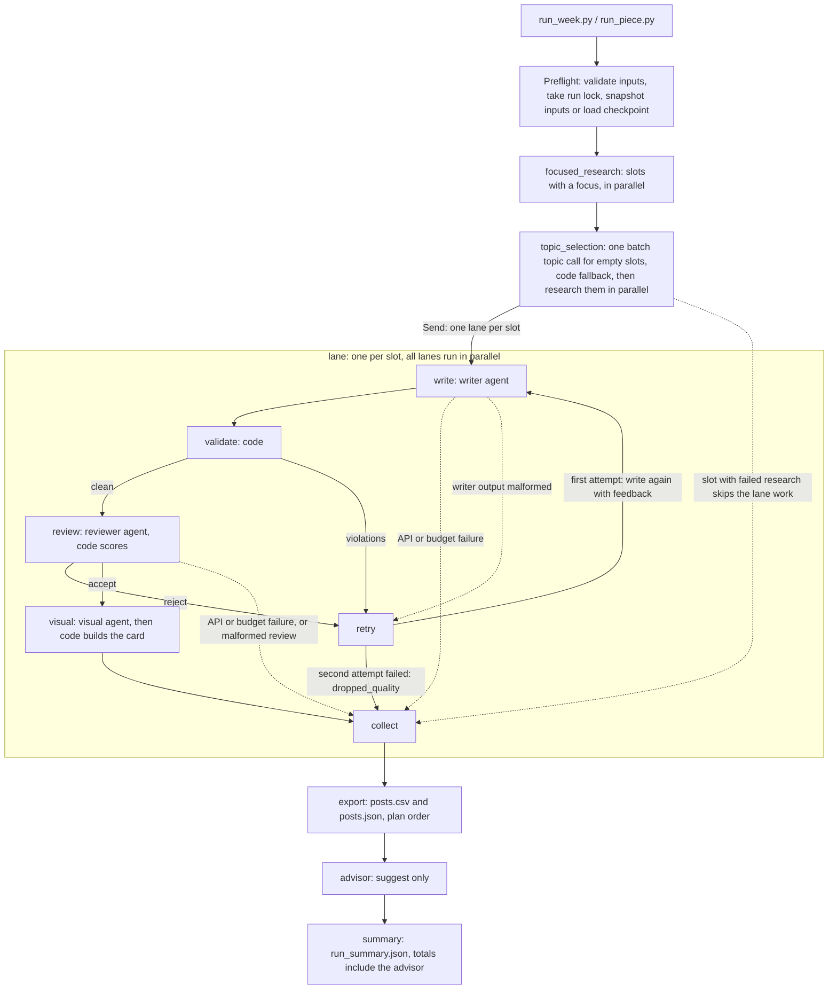

# Architecture

The pipeline is a fixed workflow. The orchestrator is plain code, not a model. Each
agent is a plain typed Python class with one job. LangGraph owns routing, parallel
lanes, the content retry and SQLite checkpoints. Which model each agent uses is configuration,
separate from the orchestration. This document describes the implemented boundaries,
tradeoffs and extension points.

## Diagram

Node names match `content_pipeline/pipeline.py` (`graph()` and `_lane_graph()`).

Every slot ends in exactly one outcome: `shipped`, `dropped_quality`, `failed_research`,
`failed_api`, `failed_budget` or `failed_output`. A failing slot is recorded inside its
lane and never stops the other lanes. Export and summary run once, after every lane ends,
even when nothing shipped.

## Why these agents

Each agent takes one typed request and returns one typed result. No agent sees the whole
run state, and none does another agent's job.

| Agent | One job | Skills |
| --- | --- | --- |
| Orchestrator (code, `pipeline.py`) | Read the plan, apply `--set`, start lanes in parallel, route retry or drop, collect results, export, summarise. | none |
| Research (`agents/research`) | Turn a slot into a topic plus sources. Searches the knowledge base first and the web only if needed. Records every source. Its topic-choice call for empty slots uses `agents/research/topics.md`. | `search_kb`, `web_search` |
| Thread writer (`agents/thread_writer`) | Write a 5 to 10 tweet thread from one research pack. | `brand_rules` |
| Marketing writer (`agents/marketing_writer`) | Write one marketing tweet from one research pack. | `brand_rules` |
| Reviewer (`agents/reviewer`) | Score the draft against the type's rubric and give a reason for each score and each rejection. | `brand_rules` |
| Visual (`agents/visual`) | Propose an image spec (concept, scene, palette, overlay text, alt text) for an accepted piece. | `brand_rules` |
| Advisor (`agents/advisor`) | After export, suggest edits to instruction files. | `brand_rules` |

Why two writers: threads and single posts need different instructions, length rules and
rubrics. Each writer has its own `system.md`; each post type adds its own `writer.md`.
Why only research can search: a writer that can search can invent a source. Writers work
from the research pack alone, and `config.py` refuses a writer that lists a search skill.
Why a separate reviewer: the model that wrote a draft should not approve it.

A skill is one module with two faces, both in the `skills/` package: `<name>.md` (prompt
text) and `<name>.py` (the code the pipeline calls). Start-up fails if an agent lists a
skill and either file is missing. `brand_rules.md` is added to the prompts of five agents.
`brand_rules.py` owns `check_brand`; the validator and the image overlay check both call it,
and the rules themselves live once, in the front matter of `inputs/brand-voice.md`.
`search_kb.py` owns `KnowledgeBase` and the search function, `web_search.py` owns
`WebSearch` and its function. Research gets the two as callable tools; `tools.py` only wraps
them and takes each tool description from the `.md` file. The old import paths
(`validation.check_brand`, `research.KnowledgeBase`, `research.WebSearch`) are re-exports.

## Where code is used instead of the model

The brief says rules belong in code and judgement in the model. The split:

| Done by code | Where |
| --- | --- |
| Routing, parallel lanes, one content retry, drop after the second failure | `pipeline.py` |
| Safe fixes: replace banned characters (em dash, en dash and the other dash look-alikes in `brand-voice.md`), normalise whitespace, straight quotes, remove a trailing hashtag block, turn markdown code fences into inline code and remove emphasis (`*word*`) outside code, since X would show both literally. Every fix is logged. | `validation.py` `validate()` |
| Tweet numbering (`1/7`); a thread tweet over the length limit is split at a sentence boundary while the thread is below its maximum tweet count, keeping its citations | `validation.py` |
| Hard checks: tweet count, weighted X length, banned words, hashtags, link allow-list, citation ids exist and have usable evidence, no source id leaked into the text, multi-digit numbers appear in the pack evidence, no tweet ends on a dangling colon, a post type's `claim_words` ("thorough", "expertise", "precise") appear only when the evidence uses them, outside code spans; rules match text after NFKC folding. A retry is told to delete the flagged clause, not reword it. These checks hold whichever model writes or reviews. | `validation.py` |
| Reviewer arithmetic: all criteria present, scores 1 to 5, reasons present, average, pass threshold, a per-criterion `min_score` floor (3), hard-fail flags. The model's own "accepted" is never trusted. One module builds the reviewer's wire schema and judges an assessment as accepted, rejected or malformed (malformed fails closed). | `review_scoring.py` `judge_review()`; `review_wire.py` only re-exports |
| Topic assignment checks: no duplicates, avoids ids from the last four runs when it can, deterministic fallback when the model's choice is missing or invalid | `research.py` `assign_topics()` |
| What a post type means: its writer, rubric, prompts, topic pool (knowledge base or angles) and brand rules, each read once per run | `post_types.py` `PostTypes` |
| The stable id `slot_id/node/attempt/call_n` of every record and model call: build, parse, next call number | `record_ids.py` |
| Budget guard: reserve the worst case before each call, refuse if it does not fit, keep uncertain charges, release the reservation after a definite provider refusal | `model_client.py`, `ledger.py` |
| Model call retries: transient errors up to three times with backoff, one longer retry after truncation, one repair re-prompt for malformed output | `model_client.py` |
| Image: checks the overlay text against brand rules and the piece, repairs a bad spec once, builds a fallback spec if that fails, draws the 1200x675 PNG card and badge | `images.py`, `pipeline.py` (visual node) |
| Image backends: tries Cloudflare FLUX when both keys are set, otherwise or on any failure draws the Pillow card; records safe failure codes | `image_backends.py` |
| Safe web fetching (public addresses only, redirects checked), CSV and JSON export, run folder trail | `research.py`, `trail.py` |

Order inside `validate()`: safe fixes first, then length splits, then numbering, then the hard checks. The
reviewer sees exactly the text that passed these checks, and that same text is exported.
Nothing edits it after approval.

Where the model is trusted: choosing and judging sources, writing, judging whether every
factual claim is supported by the evidence, and scoring the rubric. A valid source id
alone proves no claim, so the reviewer checks every factual clause, cited or not.

## Model choice is configuration

- `DEFAULT_MODEL` in `.env` (or `--default-model`) is used by every agent that does not
  set its own.
- An agent's `agent.yaml` can set `model:` to override it. The committed config pins the
  reviewer to `anthropic:claude-opus-5-5`, a larger model than the writers, and every other
  agent to `anthropic:claude-sonnet-5-5`, all at reasoning effort low. genai-prices prices
  both. Anthropic calls use native JSON-schema structured output, because Opus 5.5 rejects
  forced tool calls. A free setup is in `docs/providers-and-cost.md`.
- `MODEL_OVERRIDE` (or `--model-override`) replaces the model of every agent at once.
- Each `agent.yaml` sets its own `reasoning_effort` (low in the committed config; Mistral models
  need `none` because they reject the parameter). `REASONING_EFFORT_OVERRIDE` (or
  `--reasoning-effort-override`) replaces every agent's effort at once.
- Models are written `provider:model` and built with LangChain `init_chat_model`. The key
  comes from `<PROVIDER>_API_KEY`, except `google_genai` which uses `GEMINI_API_KEY`.
  OpenRouter, OpenCode and NVIDIA go through LangChain's OpenAI client with a base URL.
  For NVIDIA this is needed because LangChain's NVIDIA class cannot return raw usage with
  structured output.
  Another LangChain provider works without code changes once its `langchain-<provider>`
  package is installed. The Groq and Mistral packages already are.
- Instructions are files: brand voice, rubrics, writer prompts and agent prompts need no
  code change to edit.

## Data flow and boundaries

`config.py` loads settings and holds the file readers. `post_types.py` uses them to answer
what each post type, agent, prompt and the brand rules mean for one run. The nodes and
agents of a run ask that one object instead of re-reading files. `pipeline.py` validates every input
before the first call, freezes a snapshot of the inputs into the run folder, builds the
graph and keeps expected failures inside their slot.

`agents.py` defines the agents. Each receives only its request: `ResearchRequest`,
`WriteRequest`, `ReviewRequest` or `VisualRequest`. Research is the only agent with tools.
It uses BM25 over the knowledge base, lets the same chat model judge the top matches, and
may take at most four search steps. A web hit only counts as evidence when its page text
was fetched; snippets and failed fetches cannot support a claim. Code rejects non-public
addresses.

`trail.py` appends each record to its stage file once (stable record ids from
`record_ids.py`): an identical record under an existing id is skipped, and a different
record under the same id raises.
JSON models live in `models.py` and `contracts.py`; `python -m content_pipeline.schemas`
exports their schemas.

## Model calls and recovery

Every model call goes through one wrapper, `model_client.py`. It does four things:

- It keeps the token usage a provider returns, even if the answer cannot be parsed.
- It retries temporary failures up to three times: timeouts, connection errors and HTTP
  408, 429, 500, 502, 503 and 504. The wait is 1, 2, then 4 seconds, or 5, 10, then 20 for a
  429. If the provider sends a `Retry-After` header, that many seconds are used instead,
  capped at 60.
- It retries a cut-off answer once, with a 1.5 times larger output limit, and re-asks once
  when the structured output is malformed or rejected.
- It sends every attempt through the shared budget ledger.

After each attempt, one function (`_decide_attempt`) decides both the money and the next
step. Money: settle to the real usage, release the reservation, or keep it as an uncertain
charge. Next step: return, retry, expand, repair, fail, or raise the error again (cancellation, or
an error that cannot be repaired). A provider answer with HTTP 400 to
499 (except 408) is a definite refusal, so its reservation is released and the call is
recorded as confirmed with zero tokens and zero cost. 401 and 403 end the slot
`failed_api`, and 402 ends it `failed_budget`. Timeouts, connection errors, 408, 5xx,
cancellation and errors with no HTTP status stay uncertain charges.

These retries are separate from the single content retry in the graph. Errors saved in the
run folder use short error names, never provider messages.

The visual step has its own recovery on top of that. A spec with overlay errors gets one
repair call (attempt 2) with the error codes as feedback. If it still fails, code builds a
fallback spec and records a short `fallback_detail`. The card then goes through the
backends in `config/visual.yaml`: Cloudflare FLUX when both keys are set, Pillow
otherwise or after any Cloudflare failure (`fallback_reason: "cloudflare_failed"`). Calls
are counted in `external-usage.json` and not priced. The token is never written to a file,
and a log filter on the `httpx` and `httpcore` loggers drops any record that would repeat
it. That filter has limits: a logger created after the first Cloudflare call is covered
only from the next one, secrets stay in memory until the process ends, and each record
costs a small check. The Cloudflare path is tested offline only; no real call has been made.

A crashed run can be resumed. `durability.py` locks the run folder so two processes cannot
use it at once, and stores a hashed copy of the inputs. Resume reads that copy, never the
live files. LangGraph saves checkpoints to SQLite, so finished steps are skipped.
`stage_replay.py` is the one place that decides whether a saved stage record (research,
draft, review, visual, advisor) can be reused: only when its input fingerprint and the run
snapshot match. Otherwise the resume refuses with `saved stage input mismatch` before any
model call. Before a resume returns a finished run or continues past a checkpoint, it
re-checks every finished stage against its saved record the same way.

One limit to know: a step that was running when the process died can run again. If its
model call was already billed, you pay twice. Billing is not exactly once. The ledger
treats a call that was never sent as free, and a call that was sent but has no saved
result as a possible charge. Keep run folders and checkpoints private.

## Advisor and storage

After export, `advisor.py` asks a model for suggested edits to the brand voice and to each
used type's writer instructions and rubric. It reads the saved research, drafts, reviews
and final pieces. Code then checks every suggestion before it is kept. An edit must match
the current file text, must not touch the YAML front matter at the top of `brand-voice.md`
or of a rubric file, and
must not change any line that contains a number. The patch is size-capped. Code builds
`advice.patch` itself and nothing is applied for you. The advisor is off by default. If it fails, the failure is
recorded and the posts are unaffected.

SQLite holds run state for resume. The JSON files are the readable record. The committed
sample leaves out the checkpoint, lock and identity files, so it cannot resume.

## How to extend it

**Add a post type.** Add `post_types/<name>/` with `type.yaml` (writer, rubric, unit range,
numbering, research topic source, review threshold and hard-fail keys, visual template),
`writer.md`, the rubric and research hints. Add `angles.yaml` if topics come from angles.
Name an existing writer agent, or add `agents/<writer>/` with `agent.yaml` and
`system.md`. Then use the type in a plan. The orchestrator never names a post type. Tests
copy `marketing-post` to a `case-study` type and run it with no Python change
(`tests/test_pipeline_end_to_end.py:462` and `tests/test_post_type_module.py:44`;
`tests/test_post_type_module.py:79` checks that each snapshot file is read once per run). This covers types that fit research, write, validate,
review and visual. A new stage needs code.

**Add a skill.** Add both `skills/<name>.md` and `skills/<name>.py` (start-up needs both),
put the code in the `.py` file, then list it in the agent's `agent.yaml`. Research skills
must also be wrapped as tools in `tools.py`.

**Add an agent.** Add `agents/<name>/agent.yaml` and `system.md`, a class in `agents.py`
that takes one typed request, and a node in `pipeline.py`.

**Grow to 15 slots.** The plan is a list, and the graph starts one lane per slot, so a
15-slot plan needs no graph change. Raise or set `MAX_CONCURRENCY` (`--max-concurrency`)
to limit in-flight model calls against provider rate limits, and raise the token and cost
budgets from measured usage (`--estimate` shows the ceiling). Topics the system picks are
distinct within the week and avoid the last four runs when they can, so the pools matter. Empty thread
slots draw from the 20 knowledge base entries. Empty marketing slots draw from the three
angles in `post_types/marketing-post/angles.yaml`; a plan with more than three empty
marketing slots would fail the extras with `topic_pool_exhausted` until you add angles or
give those slots a focus. For a much larger knowledge base, replace BM25 with embeddings
inside `search_kb` (one file behind the research tool boundary).

**Add a second platform.** Today the length rule, the weighted counting and the CSV
exporter are X-only, and the tweet limit cannot go above 280. Make the platform a field of
the post type (maximum length, whether threads exist, numbering, CSV columns). Move the
length check and `export_posts` behind per-platform adapters, the way image backends are
meant to plug in. Writers, reviewer, research and the graph stay unchanged.

**Run it daily as a service.** Add run retention and a queue, move durability to a service
executor such as Temporal, and send advisor output to a human review queue.

## Limits

The limits of this version, and what we would do next, are listed in the
[README](README.md#known-limitations-and-what-we-would-do-next). In short: cost for models
missing from `genai-prices` and `config/prices.yaml` is unpriced (Mistral `ministral-14b` is priced there), the Cloudflare image backend is built but tested offline only (no real
call yet), the knowledge base is not owner-reviewed, and there is no exactly-once
billing on resume. No scheduler import format, publishing service or universal grounding
accuracy is claimed. Optional LangSmith tracing needs real environment variables (the
project does not load `.env` into the environment) and is not the source of truth; the run
folder is. See [verification notes](docs/verification.md) for measured coverage.
