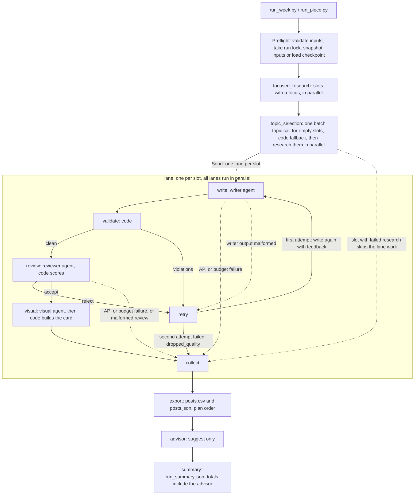

# Architecture

## In one minute

The pipeline is a **fixed workflow**, not a free-roaming agent.

- The orchestrator is plain code, not a model.
- Each agent is a plain typed Python class with **one job**.
- LangGraph handles routing, parallel lanes, the content retry and SQLite checkpoints.
- Which model each agent uses is **configuration**, kept separate from the orchestration.

The rule that shapes everything: **the model judges, code guarantees.** Models choose sources, write and
score. Code checks every rule that can be checked.

This document describes the implemented boundaries, the tradeoffs and the extension points.

**Contents**

1. [Diagram](#diagram)
2. [Why these agents](#why-these-agents)
3. [Where code is used instead of the model](#where-code-is-used-instead-of-the-model)
4. [Topic selection: decision and alternatives](#topic-selection-decision-and-alternatives)
5. [Model choice is configuration](#model-choice-is-configuration)
6. [Data flow and boundaries](#data-flow-and-boundaries)
7. [Model calls and recovery](#model-calls-and-recovery)
8. [Advisor and storage](#advisor-and-storage)
9. [How to extend it](#how-to-extend-it)
10. [Limits](#limits)

---

## Diagram

Node names match `content_pipeline/pipeline.py` (`graph()` and `_lane_graph()`).

### How a slot ends

Every slot ends in **exactly one** outcome:

- `shipped`
- `dropped_quality`
- `failed_research`
- `failed_api`
- `failed_budget`
- `failed_output`

A failing slot is recorded inside its lane and never stops the other lanes.

Export and summary run once, after every lane ends, even when nothing shipped.

---

## Why these agents

Each agent takes one typed request and returns one typed result. No agent sees the whole run state, and none does
another agent's job.

| Agent | One job | Skills |
| --- | --- | --- |
| Orchestrator (code, `pipeline.py`) | Read the plan, apply `--set`, start lanes in parallel, route retry or drop, collect results, export, summarise. | none |
| Research (`agents/research`) | Turn a slot into a topic plus sources. Searches the knowledge base first and the web only if needed. Records every source. Its topic-choice call for empty slots uses `agents/research/topics.md`. | `search_kb`, `web_search` |
| Thread writer (`agents/thread_writer`) | Write a 5 to 10 tweet thread from one research pack. | `brand_rules` |
| Marketing writer (`agents/marketing_writer`) | Write one marketing tweet from one research pack. | `brand_rules` |
| Reviewer (`agents/reviewer`) | Score the draft against the type's rubric and give a reason for each score and each rejection. | `brand_rules` |
| Visual (`agents/visual`) | Propose an image spec (concept, scene, palette, overlay text, alt text) for an accepted piece. | `brand_rules` |
| Advisor (`agents/advisor`) | After export, suggest edits to instruction files. | `brand_rules` |

### Three design choices

- **Why two writers.** Threads and single posts need different instructions, length rules and rubrics. Each writer
  has its own `system.md`; each post type adds its own `writer.md`.
- **Why only research can search.** A writer that can search can invent a source. Writers work from the research
  pack alone, and `config.py` refuses a writer that lists a search skill.
- **Why a separate reviewer.** The model that wrote a draft should not approve it.

### Skills

A skill is one module with two faces, both in the `skills/` package:

- `<name>.md` is the prompt text.
- `<name>.py` is the code the pipeline calls.

Start-up fails if an agent lists a skill and either file is missing.

What each skill file owns:

- `brand_rules.md` is added to the prompts of five agents.
- `brand_rules.py` owns `check_brand`. The validator and the image overlay check both call it. The rules themselves
  live once, in the front matter of `inputs/brand-voice.md`.
- `search_kb.py` owns `KnowledgeBase` and the search function.
- `web_search.py` owns `WebSearch` and its function.

Research gets the last two as callable tools. `tools.py` only wraps them and takes each tool description from the
`.md` file.

The old import paths (`validation.check_brand`, `research.KnowledgeBase`, `research.WebSearch`) are re-exports.

---

## Where code is used instead of the model

The brief says rules belong in code and judgement in the model. This is the split.

### Text fixes and formatting

**Safe fixes** (`validation.py` `validate()`; X formatting in `x_format.py`). Every fix is logged.

- Replace only safe banned characters (for example, non-breaking hyphens and other dash look-alikes) listed in `brand-voice.md`.
- Normalise whitespace. Curly quotes, em dashes, and separator en dashes are rejected by the AI-text checks rather than rewritten.
- Remove a trailing hashtag block.
- Turn markdown code fences into inline code, and remove emphasis (`*word*`) outside code, since X would show both
  literally.

**X formatting** (`x_format.py`), kept apart from the rule checks. None of it adds or changes a word.

- Tweet numbering (`1/7`).
- A thread tweet over the length limit is split at a sentence boundary while the thread is below its maximum,
  keeping its citations.
- Markdown that X would show literally is cleaned up.

Order inside `validate()`: safe fixes first, then length splits, then numbering, then the hard checks.

The reviewer sees exactly the text that passed these checks, and that same text is exported. Nothing edits it after
approval.

### AI-text checks

`content_pipeline/ai_text.py` checks each original piece before review for em dashes, separator en dashes, curly quotes, emoji, banned vocabulary, repeated three-item lists, and configured constructions. Vocabulary lives in `inputs/ai-vocabulary.txt`; construction regexes, hedge words, and the 3.0-per-100-word hedging threshold live in `inputs/ai-constructions.yaml`. Sentence-length count, mean, and sample deviation are retained in each draft audit for diagnostics. We use deterministic, reviewable checks rather than a third-party AI detector because detector scores are opaque and unreliable for short technical copy.

### Hard checks

All in `validation.py`, and they hold whichever model writes or reviews. Rules match text after NFKC folding
(Unicode normalization).

**Counts and format**

- Tweet count and weighted X length.
- No tweet ending on a dangling colon.

**Words and links**

- Banned words, hashtags and a link allow-list.
- A post type's `claim_words` ("thorough", "expertise", "precise") are allowed only when the evidence uses them,
  outside code spans.

**Evidence**

- Citation ids exist and have usable evidence.
- No source id leaked into the text.
- Multi-digit numbers appear in the pack evidence.
- No text points at the research material ("the article", "the discussion").

**Firm stats** (`check_stat_claims`)

- An approved stat's number keeps its noun and exact qualifier.
- Unrelated technical counts and dotted versions are ignored.
- Two stats never share a sentence.
- Optional post-type limits cap approved firm facts and brand-name mentions across a whole post.

**Repetition and structure**

- No first word opens three distinct tweets.
- No publisher derived from the pack's source titles or URLs is credited in more than one tweet.
- No non-closing tweet repeats an earlier point or example above the measured content-word threshold.
- No tweet opens with an outline label. That includes `TL;DR`, numbered mitigations and noun-phrase code labels;
  finite-verb clauses remain allowed.
- Every writer-only instruction starts with `writer_note:`.

### Review, topics and focus

**Reviewer arithmetic** (`review_scoring.py` `judge_review()`; `review_wire.py` only re-exports)

- All criteria present, scores 1 to 5, reasons present.
- Average, pass threshold, a per-criterion `min_score` floor (3) and hard-fail flags.
- The model's own "accepted" is never trusted.
- One module builds the reviewer's wire schema and judges an assessment as accepted, rejected or malformed.
  Malformed fails closed.

**Topic assignment checks** (`research.py` `assign_topics()`, `open_topics()`)

- No duplicates, and ids from the last four runs are avoided when possible.
- A deterministic ranked fallback when the model's choice is missing or invalid.
- A `topic_proposal_rejected:<slot>:<id>` warning for every choice it throws away.
- The same rule filters the pool the model is offered. See
  [Topic selection](#topic-selection-decision-and-alternatives).

**Focus guard** (`agents.py` `focus_matches()`)

- A `--set` focus must cover at least half of its words in the chosen KB entry's name, category or aliases. Hyphen
  and space variants are joined, and generic words like "value" or "proxy" are never enough alone.
- A focus that matches no entry fails closed: a KB topic that does not match ends the slot
  (`topic_does_not_match_focus`), so such a focus is only served by web research.

### Post types

**What a post type means** (`post_types.py` `PostTypes`). Its writer, rubric, prompts, topic pool (knowledge base or
angles) and brand rules, each read once per run.

- An angle can limit its approved stats (`stat_ids`).
- With `pick_one`, an angle takes the first of several KB topics that no other slot covers that week. It is recorded
  as `angle_source` in `plan.resolved.json`. A forced repeat is a `duplicate_topic` warning.
- A type's `hook_styles` and `closing_styles` are handed to its slots in plan order (thread 1 the first style,
  thread 2 the second, wrapping) as the write request's `style`. This keeps a week's threads from sharing one
  opening and ending.

### Records, budget and retries

- **Record ids** (`record_ids.py`): the stable id `slot_id/node/attempt/call_n` of every record and model call.
  Build, parse, next call number.
- **Budget guard** (`model_client.py`, `ledger.py`): reserve the worst case before each call, refuse if it does not
  fit, keep uncertain charges, release the reservation after a definite provider refusal.
- **Model call retries** (`model_client.py`): transient errors up to three times with backoff, one longer retry
  after truncation, one repair re-prompt for malformed output.
- **Safe web fetching, export and trail** (`research.py`, `trail.py`): public addresses only, redirects checked, CSV
  and JSON export, run folder trail.

### Images

**Card drawing** (`images.py` `card_style`, `render_card`; `pipeline.py` visual node)

- Checks the overlay text against brand rules and the piece.
- Repairs a bad spec once, and builds a fallback spec if that fails.
- Draws the 1200x675 PNG card.
- The post type's visual `template` picks the layout. `technical` adds the topic and the post's own longest code
  span in a code panel. `brand` adds a geometric grove motif.
- Every word on a card comes from the approved spec or post.

**Image backends** (`image_backends.py`)

- Tries Cloudflare FLUX when both keys are set.
- Otherwise, or on any failure, draws the Pillow card.
- Records safe failure codes.

### Where the model is trusted

- Choosing and judging sources.
- Writing.
- Judging whether every factual claim is supported by the evidence.
- Scoring the rubric.

A valid source id alone proves no claim, so the reviewer checks every factual clause, cited or not.

---

## Topic selection: decision and alternatives

Slots with a `focus` get their topic from research. Every other slot (an "open slot") has its topic picked once per
run, in one batch model call (`topic_selection` node, `TopicSelector` in `agents.py`). Code then checks the result.

The rule is the same one as everywhere else: **the model judges, code guarantees.**

### What the model sees

The research agent's usual system prompt plus `agents/research/topics.md`, and a `TopicChoiceRequest` with three
parts.

**`choices`**: for each open slot, the ids it may use.

- Code has already removed the ids that `assign_topics` would refuse: topics used by a focused slot this week, and
  topics from the last four runs.
- If that leaves a slot nothing, it gets its whole pool back and code decides afterwards (`history_exhausted`).
- Every id in that reset pool is refused by `assign_topics`. So the model's pick for such a slot is always rejected
  and logged as such, even when the fallback then lands on the same id.
- It is kept this way so a slot has no special case in the request. Skipping those slots would be quieter. See the
  history note below, which makes this common in a fresh clone.

**`catalog`**: what each offered id is.

- A knowledge-base id carries its name, category, severity and the first sentence of its description.
- An angle id carries only its name, because `angles.yaml` has nothing more.

**`taken`**: the topics of this week's focused slots, by slot, such as `thread_1: "KB-01 Reentrancy"`. The model
uses it to avoid overlapping them.

The model returns one id per slot and, for each, a one-line reason.

Before this change the request held bare ids (`KB-01` to `KB-20`) and the model chose blind. Nothing in its prompt
named what an id was.

### The answer shape matters

The model is asked through a schema with **one named field per open slot** (`topic_wire_schema` in `research.py`,
folded back into `TopicChoices` the way the reviewer's wire schema is).

Why not the plain contract:

- The canonical contract holds a plain `dict[str, str]`.
- A dictionary with no named keys reaches Claude as an object with no properties. With the pinned SDK (`anthropic`
  1.13.0, `langchain-anthropic` 1.7.6) the schema it receives for `assignments` is
  `{"type": "object", "properties": {}, "additionalProperties": false}`, which allows only an empty object.
- Sent that schema in a live check, Claude answered `assignments: {}`. The sample week's call used 28 output tokens,
  the size of an empty answer.
- So on Claude the original call could not name a single topic. The ranked fallback did all the work, silently.

What named fields changed:

- The same request now returns a pick and a reason for every slot.
- The fields are optional strings, not enums, so a bad id is one rejected slot, not a failed batch.
- Optional fields can still be skipped. A successful call that leaves an open slot without a pick warns
  `topic_proposal_missing:<slot>`.

Only Claude Sonnet was checked live. Gemini and the `function_calling` providers are untested here.

### What code enforces

`assign_topics` stays the only authority.

A proposal is used only if **all** of these hold:

- It is in that slot's pool.
- It is not used by a focused slot or an earlier slot this week.
- It is not in the last four runs.

Anything else is dropped with a `topic_proposal_rejected:<slot>:<id>` warning (before, it vanished silently). The
slot then gets the best-ranked free topic:

- For a knowledge-base pool: a BM25 ranking against the post type's source hints.
- For angles: the order in `angles.yaml`.

If the call fails outright, every slot takes that path and the run warns `topic_selection_failed:code_fallback`.

Reasons:

- A reason is kept in `plan.resolved.json` (`topic_reasons`) only when code took the model's pick. A rejected pick
  that the fallback happens to repeat gets no reason.
- Reasons are cut to 200 characters.
- Code never acts on a reason. It is there so a reader can audit a choice.

### Alternatives considered

| Option | Verdict |
| --- | --- |
| Model picks from bare ids (the old behaviour) | **Rejected.** It cannot tell topics apart, so its choice is guesswork that code then overrides. |
| Random pick | **Rejected.** It ignores what the post type wants (the source hints), and runs stop being reproducible. |
| Code only: drop the call and use the ranked pick | **Rejected, but close.** See below. |
| Model picks from the filtered pool with a catalog | **Chosen.** The model's judgement is used where it adds something (spread, overlap, fit) and nothing it says can break a rule of the week. |

**Why code-only lost, but only just:**

- The ranking is a fixed function of the hints. It never looks at what else is in the week, so it can give a thread
  to a near-duplicate of the focused one, or three topics from one category.
- Spreading categories is a few lines of code, since every KB entry has one. That could replace the call if this
  ever needs to be cheaper.
- Judging that two topics overlap, or that one fits a slot better, is where the model is used.
- One batch call costs about one cent. Live, final code: 4,058 in, 262 out, $0.011. The old bare-id call was 1,876
  in, 28 out, $0.004.
- Code validates every id, so a bad answer cannot break a rule. It can still be a weaker pick than the ranked one.
- We did **not** measure how often the model beats the ranked pick. The logged reasons and rejection warnings are
  what make that checkable.

### Known limitations

**Resume.** The model's proposals are not saved.

- A run that dies inside the topic node and is resumed asks the model again, and a different answer is possible.
- A slot whose research was already saved for the first assignment then meets a changed topic, and replay refuses it.
  That slot ends `failed_research` instead of swapping topics. This is tested in
  `test_replay_interrupted_research.py::test_replayed_empty_slot_research_rejects_changed_topic_assignment`.
- The fix is to save `TopicChoices` to the trail and reuse it on resume.
- Not done: the window is one node, and the failure is closed, not wrong.

**History scope.** `history()` in `pipeline.py` reads **every sibling folder of the run folder** that has a
`run_summary.json`, takes the four newest by folder modification time, and treats their topics as used.

- In this repo that includes the five committed sample folders: `sample-week`, `failed-source-example`,
  `claude-run-with-drop`, `free-run-6-of-6` and `free-run-with-drops`. Which four count depends on checkout order.
- So a first run written next to them warns `history_exhausted` (marketing posts have only three angles) for topics
  it never used itself. A live run during this change did: all three marketing picks were rejected.
- It is left as it is, because avoiding last week's topics is the feature.
- To start with a clean history, write the run into an empty parent folder (`--output elsewhere/week-42`).
- A cleaner fix would be an explicit history folder or manifest.

---

## Model choice is configuration

- `DEFAULT_MODEL` in `.env` (or `--default-model`) is used by every agent that does not set its own.
- An agent's `agent.yaml` can set `model:` to override it.
  - The committed config pins the reviewer to `anthropic:claude-opus-5-5`, a larger model than the writers.
  - Every other agent uses `anthropic:claude-sonnet-5-5`, all at reasoning effort low.
  - genai-prices prices both.
  - Anthropic calls use native JSON-schema structured output, because Opus 5.5 rejects forced tool calls.
  - A free setup is in `docs/providers-and-cost.md`.
- `MODEL_OVERRIDE` (or `--model-override`) replaces the model of every agent at once.
- Each `agent.yaml` sets its own `reasoning_effort` (low in the committed config; Mistral models need `none` because
  they reject the parameter). `REASONING_EFFORT_OVERRIDE` (or `--reasoning-effort-override`) replaces every agent's
  effort at once.
- Models are written `provider:model` and built with LangChain `init_chat_model`.
  - The key comes from `<PROVIDER>_API_KEY`, except `google_genai`, which uses `GEMINI_API_KEY`.
  - OpenRouter, OpenCode and NVIDIA go through LangChain's OpenAI client with a base URL. For NVIDIA this is needed
    because LangChain's NVIDIA class cannot return raw usage with structured output.
  - Another LangChain provider works without code changes once its `langchain-<provider>` package is installed. The
    Groq and Mistral packages already are.
- Instructions are files: brand voice, rubrics, writer prompts and agent prompts need no code change to edit.

---

## Data flow and boundaries

**Config and post types.** `config.py` loads settings and holds the file readers. `post_types.py` uses them to answer
what each post type, agent, prompt and the brand rules mean for one run. The nodes and agents of a run ask that one
object instead of re-reading files.

**Pipeline.** `pipeline.py` validates every input before the first call, freezes a snapshot of the inputs into the
run folder, builds the graph and keeps expected failures inside their slot.

**Agents.** `agents.py` defines the agents. Each receives only its request: `ResearchRequest`, `WriteRequest`,
`ReviewRequest` or `VisualRequest`.

Research is the only agent with tools:

- It uses BM25 over the knowledge base, and lets the same chat model judge the top matches.
- It may take at most four search steps.
- A web hit only counts as evidence when its page text was fetched. Snippets and failed fetches cannot support a
  claim.
- Code rejects non-public addresses.

**Trail and schemas.**

- `trail.py` appends each record to its stage file once (stable record ids come from `record_ids.py`). An identical
  record under an existing id is skipped, and a different record under the same id raises.
- JSON models live in `models.py` and `contracts.py`. `python -m content_pipeline.schemas` exports their schemas.

---

## Model calls and recovery

### The model-call wrapper

Every model call goes through one wrapper, `model_client.py`. It does four things:

- It keeps the token usage a provider returns, even if the answer cannot be parsed.
- It retries temporary failures up to three times: timeouts, connection errors and HTTP 408, 429, 500, 502, 503 and
  504.
  - The wait is 1, 2, then 4 seconds, or 5, 10, then 20 for a 429.
  - If the provider sends a `Retry-After` header, that many seconds are used instead, capped at 60.
- It retries a cut-off answer once, with a 1.5 times larger output limit, and re-asks once when the structured output
  is malformed or rejected.
- It sends every attempt through the shared budget ledger.

### After each attempt

One function (`_decide_attempt`) decides both the money and the next step.

- **Money:** settle to the real usage, release the reservation, or keep it as an uncertain charge.
- **Next step:** return, retry, expand, repair, fail, or raise the error again (cancellation, or an error that cannot
  be repaired).

How errors are charged:

- A provider answer with HTTP 400 to 499 (except 408) is a definite refusal. Its reservation is released and the
  call is recorded as confirmed with zero tokens and zero cost.
- 401 and 403 end the slot `failed_api`, and 402 ends it `failed_budget`.
- Timeouts, connection errors, 408, 5xx, cancellation and errors with no HTTP status stay uncertain charges.

These retries are separate from the single content retry in the graph.

A slot that ends in a `failed_*` outcome records the exception class and message in `run_summary.json` (`error`) and
`run.log`, with key-like strings redacted. A failed run can be diagnosed from its folder.

### Visual recovery

The visual step has its own recovery on top of that.

- A spec with overlay errors gets one repair call (attempt 2) with the error codes as feedback.
- If it still fails, code builds a fallback spec and records a short `fallback_detail`.
- The card then goes through the backends in `config/visual.yaml`: Cloudflare FLUX when both keys are set, Pillow
  otherwise or after any Cloudflare failure (`fallback_reason: "cloudflare_failed"`).
- Calls are counted in `external-usage.json` and not priced.

The Cloudflare token:

- It is never written to a file.
- A log filter on the `httpx` and `httpcore` loggers drops any record that would repeat it.
- That filter has limits: a logger created after the first Cloudflare call is covered only from the next one,
  secrets stay in memory until the process ends, and each record costs a small check.

Live runs so far got HTTP 429 from Cloudflare and fell back to Pillow.

### Resuming a crashed run

- `durability.py` locks the run folder so two processes cannot use it at once, and stores a hashed copy of the
  inputs. Resume reads that copy, never the live files.
- LangGraph saves checkpoints to SQLite, so finished steps are skipped.
- `stage_replay.py` is the one place that decides whether a saved stage record (research, draft, review, visual,
  advisor) can be reused: only when its input fingerprint and the run snapshot match. Otherwise the resume refuses
  with `saved stage input mismatch` before any model call.
- Before a resume returns a finished run or continues past a checkpoint, it re-checks every finished stage against
  its saved record the same way.

**One limit to know.** A step that was running when the process died can run again. If its model call was already
billed, you pay twice. Billing is not exactly once.

The ledger treats a call that was never sent as free, and a call that was sent but has no saved result as a possible
charge. Keep run folders and checkpoints private.

---

## Advisor and storage

### Advisor

After export, `advisor.py` asks a model for suggested edits to the brand voice and to each used type's writer
instructions and rubric. It reads the saved research, drafts, reviews and final pieces.

Code then checks every suggestion before it is kept. An edit:

- must match the current file text,
- must not touch the YAML front matter at the top of `brand-voice.md` or of a rubric file,
- must not change any line that contains a number.

The patch is size-capped. Code builds `advice.patch` itself, and nothing is applied for you.

The advisor is off by default. If it fails, the failure is recorded and the posts are unaffected.

### Storage

SQLite holds run state for resume. The JSON files are the readable record.

The committed sample leaves out the checkpoint, lock and identity files, so it cannot resume.

---

## How to extend it

### Add a post type

1. Add `post_types/<name>/` with `type.yaml` (writer, rubric, unit range, numbering, research topic source, review
   threshold and hard-fail keys, visual template), `writer.md`, the rubric and research hints.
2. Add `angles.yaml` if topics come from angles.
3. Name an existing writer agent, or add `agents/<writer>/` with `agent.yaml` and `system.md`.
4. Use the type in a plan.

The orchestrator never names a post type. Tests copy `marketing-post` to a `case-study` type and run it with no
Python change (`tests/test_pipeline_end_to_end.py:462` and `tests/test_post_type_module.py:44`).
`tests/test_post_type_module.py:79` checks that each snapshot file is read once per run.

This covers types that fit research, write, validate, review and visual. A new stage needs code.

### Add a skill

1. Add both `skills/<name>.md` and `skills/<name>.py` (start-up needs both).
2. Put the code in the `.py` file.
3. List it in the agent's `agent.yaml`.

Research skills must also be wrapped as tools in `tools.py`.

### Add an agent

1. Add `agents/<name>/agent.yaml` and `system.md`.
2. Add a class in `agents.py` that takes one typed request.
3. Add a node in `pipeline.py`.

### Grow to 15 slots

The plan is a list, and the graph starts one lane per slot, so a 15-slot plan needs no graph change.

- Raise or set `MAX_CONCURRENCY` (`--max-concurrency`) to limit in-flight model calls against provider rate limits.
- Raise the token and cost budgets from measured usage (`--estimate` shows the ceiling).

Topics the system picks are distinct within the week and avoid the last four runs when they can, so the pools matter:

- Empty thread slots draw from the 20 knowledge base entries.
- Empty marketing slots draw from the three angles in `post_types/marketing-post/angles.yaml`. A plan with more than
  three empty marketing slots would fail the extras with `topic_pool_exhausted` until you add angles or give those
  slots a focus.

For a much larger knowledge base, replace BM25 with embeddings inside `search_kb` (one file behind the research tool
boundary).

### Add a second platform

Today the length rule, the weighted counting and the CSV exporter are X-only, and the tweet limit cannot go above
280.

- Make the platform a field of the post type (maximum length, whether threads exist, numbering, CSV columns).
- Move the length check and `export_posts` behind per-platform adapters, the way image backends are meant to plug
  in.
- Writers, reviewer, research and the graph stay unchanged.

### Run it daily as a service

Add run retention and a queue, move durability to a service executor such as Temporal, and send advisor output to a
human review queue.

---

## Limits

The limits of this version, and what we would do next, are listed in the
[README](README.md#known-limitations-and-what-we-would-do-next). In short:

- Cost for models missing from `genai-prices` and `config/prices.yaml` is unpriced (Mistral `ministral-14b` is
  priced there).
- Live Cloudflare calls have only returned HTTP 429 so far, so shipped images are Pillow cards.
- The knowledge base is not owner-reviewed.
- A resumed run can pay twice for a call that was already billed.

No scheduler import format, publishing service or universal grounding accuracy is claimed.

Optional LangSmith tracing needs real environment variables (the project does not load `.env` into the environment)
and is not the source of truth. The run folder is.

See [verification notes](docs/verification.md) for measured coverage.
