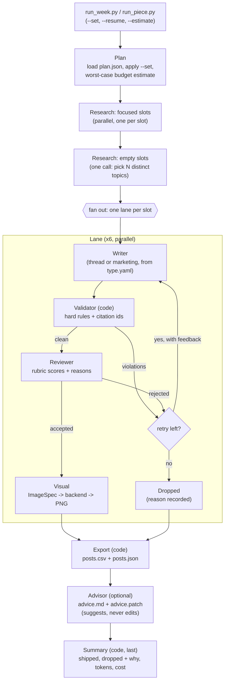

# Design: Multi-Agent Content Pipeline

This is the working design for the SanadSquad AI engineering task: a system that produces one week of X content for a smart contract audit firm. It records every decision settled in the design session on 2026-10-13/14, and it is the skeleton that `ARCHITECTURE.md` will grow from.

Source of truth for requirements: the task brief, *AI_Engineer_Task_Multi_Agent_Content_Pipeline.pdf*. Wherever this doc says "the brief", it means that file.

Target: done by **Fri 2026-10-16** (hard deadline Sun 2026-10-18).

---

## 1. The shape in one picture



It is a **fixed workflow**: the steps and their order are decided by code. Only the research agent runs a small tool loop. "Model-agnostic" is a separate property: which LLM runs inside each step is configuration.

---

## 2. Decisions

### 2.1 Orchestration

| Decision | Choice | Why |
|---|---|---|
| Framework | **LangGraph for orchestration only** | `Send` gives parallel lanes, conditional edges make retry-or-drop visible, typed state carries the handoffs, and it can render its own diagram. |
| Agents | **Plain Python classes**, callable and testable without the graph | Keeps "no agent doing another agent's job" visible in code. Graph nodes are thin glue. |
| Orchestrator | **Pure code, no LLM** | Everything it decides (routing, parallelism, retries) is fixed by config. Cheap, reproducible, can't be confused by one failure. |
| Router | Conditional edges in code | Nothing in the flow is genuinely undecided. |
| Parallel split | Research for the whole week first, then 6 lanes from Write onward | Topic de-duplication needs one choice point. Focused slots research in parallel; empty slots pick distinct topics in **one call**, excluding ids already taken. |
| Durability | **LangGraph SQLite checkpointer** in the run folder + `--resume <run_dir>` | Resuming skips nodes whose results were saved, so finished Research and Write aren't paid for again. A call billed just before a crash can repeat (§6.6). Temporal is the growth path for a daily service. |
| Advisor | Last node, every run. Writes `advice.md` + `advice.patch` against `writer.md` / `rubric.md` / `brand-voice.md` | Suggest-only. Auto-editing prompts would drift and loosen its own rubric. A human runs `git apply`. |

### 2.2 Handoffs and state

Each agent takes one Pydantic model in and returns one out:

```
ResolvedSlot --Research--> ResearchPack --Writer--> Draft --Validator--> ValidationResult
     --Reviewer--> Review --Visual--> ImageSpec --backend--> ImageResult
```

- `WeekState` holds `slots: dict[slot_id, SlotState]`. Each lane gets its own `SlotState` via `Send`; a reducer merges finished lanes back.
- Nodes map state to the agent's input, call the agent, and write the output back. Agents never see `WeekState`.
- A `trail` module appends each contract to its stage file as nodes finish. The run folder is a **view** of state, not the state itself.

### 2.3 Extensibility layout

```
post_types/
  tech-thread/      type.yaml  writer.md  rubric.md
  marketing-post/   type.yaml  writer.md  rubric.md  angles.yaml
agents/
  research/  thread_writer/  marketing_writer/  reviewer/  visual/  advisor/
             each: agent.yaml (model override?, max_output_tokens, reasoning_effort, skills) + system.md
             (a writer's prompt = agents/<writer>/system.md + post_types/<type>/writer.md + brand voice)
skills/
  search_kb.py + .md     (research only; writers never search, see §6)
  brand_rules.py + .md   (shared: writers, reviewer, visual, validator)
  web_search.py + .md    (research)
  build_image_prompt.py + .md (visual)
config/
  visual.yaml       image backend order
inputs/
  brand-voice.md  kb.json  plan.json
```

- The orchestrator reads `slot.type` and loads `post_types/<type>/`. It never names a post type. **Adding a post type = adding a folder.**
- `type.yaml` names the writer, the rubric, tweet-count range, pass threshold. Full contract in §6.9.

### 2.4 Inputs

- **`brand-voice.md`**: YAML front matter for machine-readable rules (banned words, banned characters, allowed links, approved stats as `STAT-01`…, `brand_name`), prose below for tone, passed to writers verbatim.
- **Brand name**: one field. Ships with a neutral made-up firm name and clearly fake stats; README explains how to set `brand_name: SanadSquad`.
- **`kb.json`**: 18–20 vulnerabilities drafted from public taxonomies (SWC Registry, OWASP Smart Contract Top 10). Each entry: `id, name, severity, category, description, root_cause, aliases, references` (URLs). Kassra reviews them.
- **`plan.json`**: slots `thread_1..3`, `marketing_1..3`, each with `type` and optional `focus`.

### 2.5 Research and grounding

| Decision | Choice |
|---|---|
| Source priority | **Knowledge base first**; web only when the KB doesn't cover a focus. |
| KB retrieval | **BM25** (`rank-bm25`) over name, category, description and `aliases` -> top 5 -> **the same chat model** judges the match (no separate classifier, no Jev). |
| Web search | `web_search` skill: **Tavily**, then **`ddgs`** (no key) as fallback. A failed or empty search marks the slot **failed**; the run continues. |
| Research loop | Max 4 search steps; evidence text capped before it enters the prompt. Every web hit becomes a `SourceRecord` (§6.2). |
| Topic repeats | Topics the system picks never repeat within a week or with the last 4 run folders. Explicit focuses may repeat (warning). Details: §6.3. |
| Marketing angles | `angles.yaml` (`service`, `credibility`, `education-to-cta`); an empty focus gets a distinct angle. |
| Citations | One scheme for every source type: `KB-07`, `STAT-02`, `WEB-<hash>`. **No `USER` source**: `--set` sets a topic, not evidence (§6.1). |
| Grounding check | Writers return structured output with **source ids per tweet**. **Code** checks every id exists in that slot's research pack. The **reviewer** checks **every factual claim** against the evidence text, including claims the writer didn't cite (§6.2). |

### 2.6 Quality gates

**Validator (code, not an agent)** runs after every draft:
- Hard rules from `brand-voice.md` front matter + `type.yaml`: banned characters (em dashes), hashtags, banned words, link allow-list, tweet count, **280 chars per tweet counted by X's rules via `twitter-text-parser`** (weighted Unicode, URLs = 23), with the `1/7` numbering added by code **after fixes and before hard checks and review**. `MAX_TWEET_CHARS` comes from `.env` and may only **lower** the limit (§6.11).
- **Safe fixes** (listed in config: banned-character replacement, whitespace, curly quotes, a trailing hashtag block) are applied and **logged** in the drafts trail. Banned-character replacement handles configured banned characters as specified in §6.11 and leaves URL-like tokens unchanged; remaining violations go back to the writer.
- **Real violations** skip the reviewer and go straight back to the writer as the one retry. A retry that still breaks a hard rule is dropped.

**Reviewer**: 1–5 per rubric criterion (hook, technical accuracy, grounding, voice, clarity, CTA). Pass = average ≥ threshold (from `type.yaml`) and no hard-fail criterion (e.g. unsupported claim). Every rejection carries reasons.

**Retry kinds** (recorded separately in the trail):
1. **Content retry**: exactly one, per the brief. Feedback = validator violations + reviewer reasons.
2. **Transient API errors**: up to 3 with backoff, in the model client. Still failing -> slot failed, run continues.
3. **Truncation** (`finish_reason=length`): one retry at 1.5x `max_output_tokens`. It is billed and goes through the budget.

### 2.7 Models

- **One `DEFAULT_MODEL`** (in `.env`) for every agent. `agent.yaml` may override per agent; `MODEL_OVERRIDE` swaps all of them for a cheap test run.
- Calls go through LangChain `init_chat_model("provider:model")`. OpenRouter is the default gateway in `.env.example`; direct providers (Gemini, OpenCode Zen, Anthropic, OpenAI) also work.
- `reasoning_effort` per agent: reviewer `medium`, everyone else `none`/`low`.
- Keys and runtime settings in `.env` (gitignored), all listed in a committed `.env.example`. Precedence: CLI flag > `.env` > file default.

### 2.8 Tokens, cost and budget

**Measurement**
- Every model call goes through one wrapper. Tokens come from `usage_metadata` (structured output uses `include_raw=True`); provider-only fields are read from `response_metadata`. A gateway that returns no usage gets an estimate, flagged `estimated`.
- Reasoning/thinking tokens are counted and billed as output. Cached input is normalised before pricing.

**Pricing** (no hand-kept table)
1. Provider-reported cost if present: OpenRouter `usage.cost + cost_details.upstream_inference_cost` (on BYOK, `usage.cost` alone is only OpenRouter's fee; see §4).
2. Else pydantic **`genai-prices`** with `UpdatePrices` on, bundled prices as offline fallback.
3. Else unknown. An unpriced model is **refused** unless `--allow-unpriced`, in which case only the token cap applies and the summary warns.
- Every call records `cost_source: provider | genai-prices@<version> | unknown`.

**Budget (pre-call budget guard; see §6.7 for what it does and doesn't guarantee)**
- `RUN_TOKEN_BUDGET` and `RUN_COST_BUDGET_USD` in `.env`; whichever is hit first stops spending.
- A run-level **ledger** shared by all lanes, behind an `asyncio.Lock`. Before each call it reserves the worst case: estimated input (chars / 3.5, +15%) + full `max_output_tokens`. If it doesn't fit, the call never starts. After the call, the reservation is settled to actual numbers.
- `max_output_tokens` per agent in `agent.yaml`, sized at about 2x the largest legitimate output (thinking included).
- Budget exhausted -> that slot fails with `budget_exhausted`; finished lanes still export. Export and summary are code and always run.
- The budget is the run's **lifetime total**: the ledger lives in the run folder, so `--resume` continues against it; raise it with `--token-budget`.
- Startup prints the plan's worst case vs budget as a warning. `--estimate` prints it and exits without spending.
- Defaults (`250000` tokens, `$1.00`) are placeholders, reset from the first live run's measured usage plus margin.
- Backstop outside our code: a credit limit on the provider key (set by hand). Provider caps are monthly and lag, so they are never the per-run cap.

### 2.9 Images

```
Visual agent (LLM) -> ImageSpec (concept, scene, palette, overlay text, alt text)
  -> backend chain from config/visual.yaml: [cloudflare_flux, pillow_card]
  -> overlay step (Pillow): title + severity badge drawn by code on whatever came back
```

- Cloudflare Workers AI FLUX-schnell (free daily allowance, needs account id + token). No key or any failure -> Pillow card, so a run never breaks. The trail records which backend produced each image.
- On-image text is always drawn by code: image models garble text.
- Images are made **only for accepted pieces**. Visual-agent failure and overlay validation: §6.5.

### 2.10 Output

**Run folder** (`output/<run>/`), one JSON file per stage for the whole week; every record carries `slot_id` and `attempt`:

```
plan.resolved.json  research_log.json  drafts.json  review_report.json
final.json  run_summary.json  usage.jsonl  advice.md  advice.patch
posts.csv  posts.json  images/  run.log  checkpoint.sqlite
```

- Schemas are Pydantic models, exported as JSON Schema into `schemas/`.
- **`posts.csv`**: columns `Post Text, Image`, one row per accepted piece. Thread tweets go in one cell, each on a new line with a `1/7` prefix.
- **`posts.json`**: the same accepted pieces with each thread's tweets as a separate array, for easy reading and testing.

### 2.11 CLI

```
python run_week.py --plan inputs/plan.json --output output/week-42
python run_week.py --plan inputs/plan.json --set thread_2="oracle manipulation"
python run_week.py --resume output/week-42 --token-budget 400000
python run_week.py --plan inputs/plan.json --estimate
python run_piece.py --type tech-thread --topic "reentrancy"
```

- `--set slot=text` fills that slot's focus. It is a topic, not evidence: it still has to resolve to KB or web evidence.
- `run_piece.py` builds a one-slot plan in memory and runs **the same graph**, with its own run folder.

### 2.12 Tests and observability

- **pytest with a fake LLM** (scripted outputs): validator rules, citation checking, `--set` parsing, retry-then-drop, one slot failing while the run continues, budget refusal. No keys, no cost.
- A **live smoke test** behind `--live`; this produces the committed sample run in `output/`.
- Optional LangSmith tracing via env vars only. The run folder is the source of truth.

---

## 3. Plan

| Day | Work |
|---|---|
| **Wed 14** | Repo, inputs (brand voice, KB, plan), Pydantic contracts, model wrapper + usage ledger + pricing, validator + citation checker, skills (`search_kb`, `web_search` + page fetch, `brand_rules`), terminal-state enum, pytest with fake LLM. |
| **Thu 15** | Agents (research, 2 writers, reviewer, visual), LangGraph graph with parallel lanes and retry-or-drop, trail writer, both CLIs, Pillow card. |
| **Fri 16** | Advisor node, Cloudflare adapter, `--resume`, live sample run, README + ARCHITECTURE.md + limitations. |

**Cut order if behind**: Cloudflare adapter -> `--resume` flag (checkpointer stays) -> advisor. Nothing the brief requires is on this list.

## 4. Verified against the real APIs (2026-10-14)

| # | Question | Finding | How verified | Design consequence |
|---|---|---|---|---|
| 1 | What is OpenRouter `usage.cost` on a BYOK call? | `usage.cost` is "the total amount charged to your account", so on BYOK it is OpenRouter's fee only. The provider's real cost is in `usage.cost_details.upstream_inference_cost` (filled only for BYOK). `is_byok` is not in the completion response; it is in `GET /api/v1/generation`. Usage is now always returned; `usage: {include: true}` is deprecated. Fee: 5% after $25k/month of list-price inference. Key limit hit = **403** with `limit_source: "openrouter_key_limit"`; **402** = out of credits. | Official docs: [usage accounting](https://openrouter.ai/docs/use-cases/usage-accounting), [BYOK](https://openrouter.ai/docs/guides/overview/auth/byok), [errors](https://openrouter.ai/docs/api-reference/errors). No live call (no OpenRouter key in this shell). | Provider cost = `usage.cost + (cost_details.upstream_inference_cost or 0)`. Map 403 `key_limit` and 402 to a non-retryable `budget_exhausted`-style failure, not a transient retry. |
| 2 | Does LangChain normalise Anthropic cache tokens? | Yes. `langchain_anthropic._create_usage_metadata` adds `cache_read` + `cache_creation` back into `input_tokens`, so `input_tokens` is the true total (OpenAI convention). 5m/1h cache writes are kept as `ephemeral_5m_input_tokens` / `ephemeral_1h_input_tokens` in `input_token_details`. Anthropic thinking tokens are inside `output_tokens` but are **not** broken out as `output_token_details.reasoning`. | Read installed source: `langchain_anthropic` 1.4.0, `langchain_core` 1.6.0. | Treat `usage_metadata.input_tokens` as total input for every provider. Don't rely on `output_token_details.reasoning` existing; it's for display only. |
| 3 | Is usage available with structured output? | Yes, with `with_structured_output(schema, include_raw=True)` the runnable returns `{"raw": AIMessage, "parsed": ..., "parsing_error": ...}`; usage is on `raw.usage_metadata`. | `langchain_core` 1.6.0 docstring. | The model wrapper always uses `include_raw=True`, records usage from `raw`, and treats `parsing_error` as a failed call (billed). |
| 4 | Does Gemini `candidatesTokenCount` include thoughts? | **No.** Live call to `gemini-2.5-flash` with `thinkingBudget: 512`: prompt 13 + candidates 34 + thoughts 510 = total 557. `langchain_google_genai` 4.2.1 already sets `output_tokens = candidates + thoughts`. Note: the model spent 510 of a 512 thinking budget on a one-line answer. | Live REST call with `GEMINI_API_KEY`; read installed source. | Use LangChain's `output_tokens` as is. Thinking eats budget fast, which confirms `reasoning_effort: none/low` as the default for everyone but the reviewer. |
| 5 | `genai-prices` API surface | v0.1.11. `calc_price(Usage(input_tokens=, output_tokens=, cache_read_tokens=, cache_write_tokens=), model_ref, provider_id=...)` returns `.total_price` (Decimal) and `.model`. Knows `google`, `anthropic`, `openai` and `openrouter` model ids (e.g. `google/gemini-2.5-flash`). **Unknown model raises `LookupError`.** `UpdatePrices(update_interval=3600, url=<raw GitHub main>)` fetches live data. | Installed in a scratch venv and called. | Unknown model -> `LookupError` -> refuse unless `--allow-unpriced` (as designed). `UpdatePrices` reads from GitHub `main`, so a fetch failure falls back to bundled prices and is logged. |

## 5. Growth paths (for ARCHITECTURE.md)

- **15 slots**: unchanged graph; raise `MAX_CONCURRENCY`; swap `search_kb` from BM25 to embeddings (one file) as the KB grows.
- **Second platform**: platform becomes a field on the post type (`max_chars`, thread support, CSV format); exporters become adapters like the image backends.
- **Daily service**: Temporal for durable execution; advisor feeding a review queue.

---

## 6. Closures from the external design review (2026-10-14)

An independent model reviewed this design against the brief, twice. Kassra accepted the findings below. §2 has been corrected in place wherever it contradicted them; if any conflict remains, §6 wins and it's a doc bug to fix.

Priority: 6.1–6.5, 6.8 and 6.10 are part of the required pipeline. 6.6 (resume) and 6.7 (budget) stay optional and keep their place on the cut list.

### 6.1 A topic override is not evidence
- `--set thread_2="oracle manipulation"` sets `requested_focus` only. It must still resolve to KB entries or web `SourceRecord`s like any other focus.
- **`USER` is removed as a citation source.** The brief's CLI has no way to supply facts, so nothing the user types can support a claim.

### 6.2 What counts as evidence
- Every source a writer can cite is a `SourceRecord`:
  `source_id, kind (kb | stat | web), url?, title, retrieved_at, evidence_text, status (ok | snippet_only | fetch_failed)`.
- KB and STAT records carry their own text. Web records:
  - **Tavily**: use its returned page content as `evidence_text`.
  - **`ddgs`**: snippets only, so the page is fetched and extracted with **`trafilatura`**.
  - Search succeeds but fetching fails -> `fetch_failed`, not citable. If a slot ends with no citable evidence, it becomes `failed_research`.
- The **writer and the reviewer receive the same `SourceRecord`s**. All records are saved in `research_log.json`, so evidence can be inspected after the run.
- Writers cite per tweet. The **reviewer checks every factual claim** in the text against `evidence_text`, including claims the writer didn't cite. An unsupported claim is a hard fail.

### 6.3 Topic assignment can't sink several slots
- The batch "pick N distinct topics" call is validated by **code**: every empty slot assigned, every id exists, no duplicates with each other, with focused slots, or with history.
- Valid assignments are kept. A missing or invalid one is filled by **code**, from that post type's `topic_source` (§6.9): the best unused **KB entry** (BM25 against the type's research hints) for `kb`, or the next unused **angle** from the type's angles file for `angles`. No second LLM call.
- **Topic selection may fall back; evidence may not.** After a topic is chosen (by the model or the fallback), its evidence is resolved normally (§6.2). If evidence resolution fails or returns malformed output, the slot is `failed_research`. Code never invents evidence.
- Two **explicit** focuses resolving to the same KB id are allowed (it's the user's choice) and logged as a warning.
- History exclusion: ids used in the **last 4 run folders**. If the pool is exhausted, the least recently used ids are allowed again, and this is logged.

### 6.4 Writers never search
- Writers work **only** from their slot's research pack; they don't call `search_kb`.
- The shared-skill requirement is met by **`brand_rules`**, used by writers, reviewer, visual and validator.
- **What a skill is**: one module with two faces: its `.md` prompt text and the `.py` code the
  pipeline calls. The old import paths (`validation.check_brand`, `research.KnowledgeBase`,
  `research.WebSearch`) stay as re-exports of the skill modules; nothing re-implements them.
  - Research gets its skills as **LLM-callable tools** (`search_kb`, `web_search`).
  - For every other agent, a skill contributes **instruction text** to the prompt and/or **functions called by code** (e.g. `brand_rules.check_brand()` used by the validator and the overlay check).

### 6.5 Visual failure and accuracy
- If the visual agent fails (error, invalid output, budget refusal), **code builds a fallback `ImageSpec`** from the accepted piece: title from the topic name, severity from the KB entry if any, brand palette.
- Overlay text shares **hard brand checks** with tweets, not normalisation or tweet numbering, and may only contain text from the accepted piece or its sources. No new statistics.
- The **severity badge is optional**; it is drawn only when the source has a severity, so marketing posts have none.
- The Pillow card is local code, so an accepted piece always ships with an image. If even that fails, the piece ships with its written spec and the CSV `Image` cell points to the spec JSON. That is recorded.

### 6.6 What resume can and can't promise
- **Limitation, documented:** if a call completes and is billed but the process dies before the result is saved, `--resume` repeats that call. No exactly-once billing.
- Every model call and trail record has a **stable id** (`slot_id/node/attempt/call_n`). The trail writer skips ids it already has, so resume never duplicates records.
- On resume, a reservation left open by a crash is released **only if the call was never dispatched** (the ledger writes a `dispatched` mark before sending). A dispatched call with no saved result stays an **uncertain charge**, exactly like a timeout (§6.7).
- Each run **snapshots** its inputs (`brand-voice.md`, `kb.json`, `plan.json`, `post_types/`, `agents/`, resolved config) into `run_dir/snapshot/`. Resume reads the snapshot, not the live files, so one run can't mix two policies.

### 6.7 What the budget guarantees
- It is a **pre-call budget guard**, not a mathematical hard cap. Input tokens are estimated (chars / 3.5 + 15%), and an estimate can be wrong for unusual text.
- The guard reserves that estimate plus full `max_output_tokens` before each call. Any actual overshoot is recorded in `usage.jsonl` and the summary.
- A call that was dispatched but has no recorded result (timeout, crash) may still have been billed: its reservation is kept as an **uncertain** charge and never released. The summary reports **confirmed** and **uncertain** spend separately.
- **Scope:** LLM spend only. Search and image calls are counted (calls, Tavily credits, Cloudflare neurons) but not priced in USD. The summary says so.
- The brief requires cost **reporting**, not a cap. Kassra wants the guard, but it stays simple and never blocks the required pipeline work.

### 6.8 CSV and export, stated honestly
- `posts.csv` is **the brief's export format**: `Post Text, Image`, one row per accepted piece, rows in plan order.
- **Scope (Kassra, 2026-10-14):** the deliverable is the CSV the brief specifies. We don't target or test any particular scheduler's import format, and the docs don't claim compatibility with one.
- `Image` = path **relative to the run folder** (`images/thread_1.png`).
- The `1/7` numbering is added by code **after fixes and before hard checks and review**. The text the reviewer approved is byte-for-byte the text exported. Nothing edits text after approval.

### 6.9 The `type.yaml` contract
```yaml
name: tech-thread
writer: thread_writer          # agents/<name>/
rubric: rubric.md
units: {min: 5, max: 10}       # tweets; marketing-post: {min: 1, max: 1}
numbering: true                # add "1/N" prefixes
research:
  hints: research.md           # what good sources for this type look like
  topic_source: kb             # kb | angles
  angles: null                 # e.g. angles.yaml for marketing-post
review:
  pass_avg: 3.5
  hard_fail: [unsupported_claim, off_brand]
visual:
  template: technical          # Pillow card template
  severity_badge: auto         # auto | never
```
- **Acceptance test:** add a third post type (e.g. `case-study`, a single post) as folders only, and run it with **no Python change**.
- **Scope of the promise:** new types that fit the existing pipeline (research -> write -> validate -> review -> visual) and contracts. A type needing a new stage needs code.

### 6.10 Malformed outputs and terminal states
- Malformed structured output at any stage gets **one repair attempt**: re-prompt with the parse error. It doesn't use the content retry and it is billed through the budget.
- Still malformed:
  - writer -> counts as the content rejection;
  - **reviewer -> fails closed** (`failed_output`). Malformed review output never counts as approval;
  - visual -> fallback spec (§6.5);
  - research -> `failed_research`.
- Every slot ends in **exactly one terminal state**: `shipped`, `dropped_quality`, `failed_research`, `failed_api`, `failed_budget`, `failed_output`.
- Expected slot-level failures are caught inside the lane and recorded. They never escape and stop the graph.
- **Run order at the end:** Export -> Advisor (optional) -> finalize usage -> Summary. The summary is last so its token and cost totals include the advisor. If the advisor fails, it is recorded in the summary (`advisor: failed, reason`); shipped content and the CSV are untouched and the run still completes.
- Export and summary run **once**, after every lane reaches a terminal state, **including when zero pieces ship** (an empty CSV with headers).

### 6.11 Validator semantics
- Length: **`twitter-text-parser`** (X's weighted counting: Unicode weights, URLs = 23). `MAX_TWEET_CHARS` in `.env` may set a **lower** editorial limit (default 280). A value above 280 is a startup error: longer posts would be a future platform capability (e.g. Premium), declared explicitly, not a config tweak.
- Links: **domain** allow-list (subdomains allowed only if listed).
- Banned words and phrases: **case-insensitive, word-boundary** matching. Banned characters: exact.
- Safe fixes are only: **banned-character replacement**, whitespace normalisation, curly to straight quotes, and removing **a trailing block of hashtags**. A hashtag inside a sentence is a violation, not a fix.
- Banned-character replacement (Kassra, 2026-10-15; supersedes the earlier rule that banned characters always go back to the writer): when `banned_characters` is listed in `safe_fixes`, configured banned em dash runs (including surrounding whitespace) are removed at tweet boundaries; internal runs become ", ", except beside punctuation (`, . ; : ! ? ) (` and quotes), where the run is removed with a single space where needed. Consecutive em dashes form one run. Configured banned U+2011 becomes "-"; other configured banned characters are removed. Empty or punctuation-only results are rejected before numbering. URL-like whitespace-delimited tokens (containing "://", starting with "www.", or matching a bare domain with a path) are never changed by this replacement; a banned character inside one goes back to the writer. Replacement runs before other fixes, then numbering, hard checks and review. In the live Mistral week at 56a0b7c, two of the dropped threads, thread_1 and thread_3, failed only for em dashes. Without the fix configured, a banned character is still a violation. Banned words, hashtags inside text, links and length are never auto-fixed.
- The original draft is kept beside the fixed one in `drafts.json`. Fixes happen before review. Approved text is never modified afterwards.

### 6.12 Tests that back the claims
Fake-LLM tests (routing and rules), in addition to §2.12:
- unknown citation id; **valid id that doesn't support the claim** (reviewer stub rejects, so the routing is proven);
- batch topic assignment with a missing slot and a duplicate;
- visual-agent failure -> fallback spec; overlay text with a banned word;
- concurrent budget reservations and concurrent trail writes (no lost or duplicate records);
- resume skips completed nodes and doesn't duplicate trail records (if `--resume` survives the cut);
- a post type added by files only (§6.9 acceptance test);
- CSV round-trip: a thread survives write -> read with numbering and newlines intact;
- malformed reviewer output -> `failed_output`, never shipped; zero shipped -> header-only CSV.

**Live check** (a few real calls): one piece with a **deliberately unsupported claim** must be rejected by the real reviewer. Fake-LLM tests prove routing; only this proves grounding judgement.
